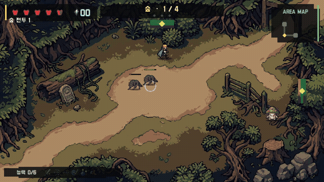

# 소울 아처 (Soul Archer)

**움직이면 회피하고, 멈추면 공격합니다.** 궁수 레온을 조작해 숲과 동굴, 마왕의 성을 지나 엘리아 공주를 구하는 싱글플레이 2D 액션 게임입니다. 언제 움직이고 언제 멈춰 싸울지 판단하는 것이 플레이의 중심입니다.

[English](README.md)

## 실제 플레이 영상

**[▶ 소리와 함께 70초 플레이 영상 보기](https://powerpunch777.github.io/school-arcade-unity/)** · [MP4 다운로드](https://powerpunch777.github.io/school-arcade-unity/gameplay.mp4?v=20261023)

첫 숲 전투에서 적을 피해 움직이고, 멈춰서 공격한 뒤, 능력을 선택하고 다음 방에 진입하는 모습을 담았습니다. 실제 게임의 배경음악과 효과음을 함께 녹화한 정상 속도 영상입니다. 한국어 게임 화면을 설명하는 영어 자막이 기본으로 표시되며, 플레이어에서 한국어 자막도 선택할 수 있습니다. 위의 움직이는 미리보기는 무음 GIF이므로, 소리는 전체 영상을 열어 재생하면 들을 수 있습니다.

- **0:00 — 숲 전투:** 적과 투사체를 피해 이동하고, 멈춰서 공격합니다.
- **0:51 — 능력 선택:** 이번 플레이에서는 관통, 공격, 회복이 선택지로 나옵니다.
- **0:56 — 다음 전투 준비:** 관통 능력을 선택한 뒤 클리어한 방으로 돌아옵니다.
- **1:00 — 다음 방 진입:** 새로운 전투가 시작됩니다.

## 어떤 게임인가요?

### 공격할 순간을 찾습니다

WASD나 방향키로 이동합니다. 이동 중에는 새 화살을 발사할 수 없고, 이동 키에서 손을 떼면 화면 안의 가장 가까운 적을 자동으로 조준해 공격합니다.

이 단순한 규칙으로 타이밍과 위치 선정이 중요해지도록 만들고 싶었습니다. 멈추면 적에게 피해를 줄 수 있지만 그만큼 공격에 노출됩니다. 적이 다가오는 상황에서 한 발 더 쏠 시간이 있는지, 안전한 곳으로 움직여야 할지 판단해야 합니다.

### 다음 전투를 위한 능력을 고릅니다

방을 클리어하고 능력을 고르며, 상점을 방문하고 각 지역의 보스로 향하는 길을 찾습니다. 숲에서 동굴로, 마지막에는 성으로 이어지며 지역마다 다른 적과 보스 패턴을 만나게 됩니다.

*영상과 별도로 촬영한 플레이에서 첫 방을 클리어한 뒤 나온 선택지입니다. 더 빠르게 이동할지, 화살로 적 하나를 더 관통할지, 공격 간격을 줄일지 선택합니다. 선택한 능력에 따라 다음 전투에 대응하는 방법이 달라집니다.*

스크린샷 더 보기

*별도의 플레이에서 캡처한 첫 숲 전투 장면입니다.*

*여기서 여정을 시작합니다. 쉬움 또는 보통 난이도로 새 게임을 시작하거나, 이전 전적과 조작법을 확인할 수 있습니다.*

*영상과 스크린샷은 모두 CMP-265 Windows 빌드를 직접 실행해 캡처했습니다. 현재 게임 화면은 한국어입니다. [촬영 정보](Documentation/Media/README.md).*

## 만든 이유와 제가 맡은 일

생성형 AI가 게임 개발을 어떻게 도울 수 있는지 탐구하는 학교 프로젝트로 시작했습니다. 직접 플레이하고 개선할 수 있는 게임을 만들어 그 가능성을 확인하고 싶었습니다.

저는 기획, 핵심 규칙 설계, 구현 방향 결정, 플레이테스트를 맡았습니다. AI는 아이디어를 빠르게 구현하고 시각자료를 만드는 데 활용했습니다. 게임이 어떻게 작동해야 하는지 결정하고, 결과를 검토하며, 무엇을 수정할지 찾는 것은 제가 담당했습니다.

## 플레이하면서 바꾼 것

**전투가 의미 있는 선택으로 이어지도록 조정했습니다.** 초기에는 게임이 너무 쉽고 빨리 끝났습니다. 이동과 공격 사이에서 판단할 필요가 더 생기도록 몬스터 체력과 보스 패턴을 조정하고, 다시 플레이하며 변화를 확인했습니다.

**그래픽은 실제 게임 안에서 확인하며 수정했습니다.** 의도대로 표시되지 않는 그래픽은 생성형 이미지 도구로 대체 자료를 만들고 수정했습니다. 캐릭터, 적, 배경, 인터페이스가 함께 보이는 게임 화면에서 결과를 확인했습니다.

이 과정에서 아이디어가 실행되게 만드는 것은 시작이라는 점을 배웠습니다. 기획만으로는 보이지 않던 문제가 플레이 중 드러났고, 그 문제가 다음에 무엇을 만들어야 할지 결정하는 기준이 되었습니다.

작업환경으로는 함께 개발 중인 [SPS](https://github.com/Powerpunch777/SPS)를 사용했습니다. Soul Archer를 만들며 작업환경의 부족한 점을 발견했고, 게임과 도구를 함께 개선했습니다.

## 더 살펴보기

[게임 기획 문서](https://github.com/Powerpunch777/school-arcade-design) · [Unity 실행 및 개발 안내](Documentation/Development.ko.md) · [에셋 출처와 라이선스](Documentation/THIRD_PARTY_NOTICES.md)

Unity와 C#으로 제작한 Windows 게임입니다. 원본 코드와 자체 제작 리소스에는 별도 오픈소스 라이선스를 부여하지 않으며, 제3자 에셋에는 각각의 라이선스가 적용됩니다.
