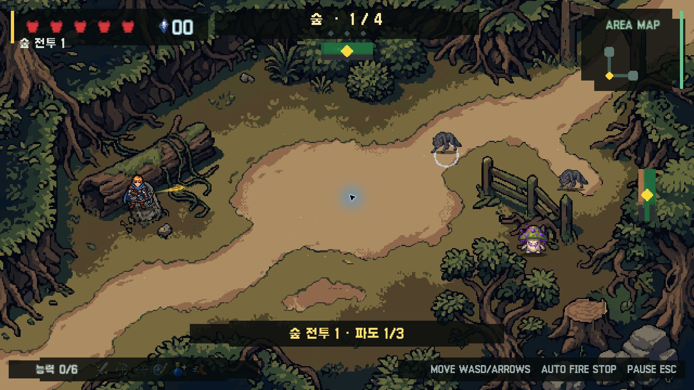
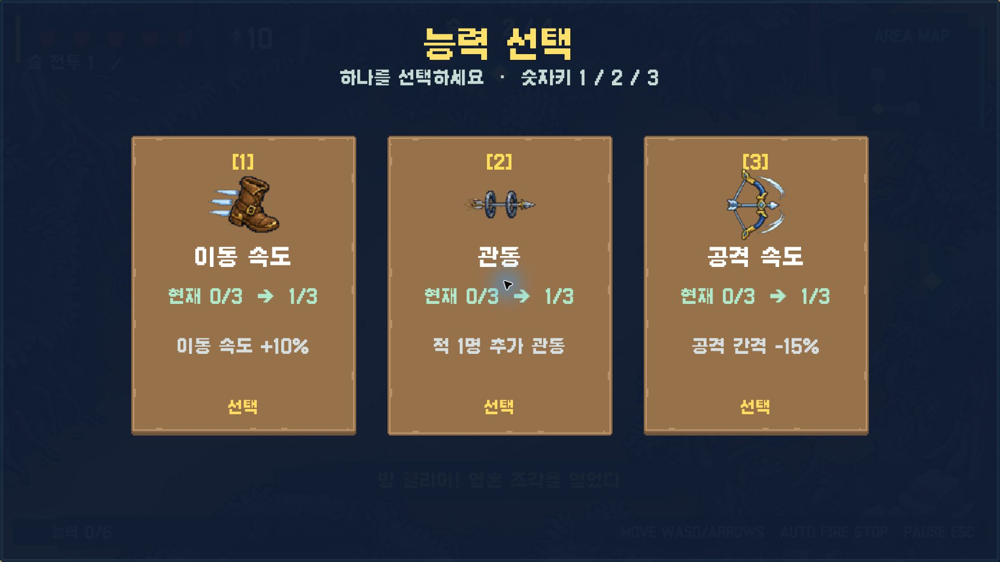
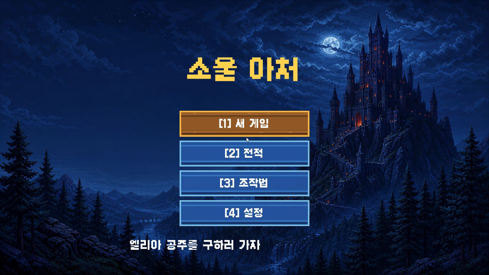

# Soul Archer

**Move to dodge. Stop to shoot.** Soul Archer is a 2D action game built in Unity for Windows. The player controls an archer who automatically targets nearby enemies while standing still, creating a repeated choice between avoiding danger and dealing damage.

[한국어](README.ko.md) · [Game design documents](https://github.com/Powerpunch777/school-arcade-design) · [SPS development workspace](https://github.com/Powerpunch777/SPS) · [Run the project](#run-the-project)

*Captured directly from the CMP-265 Windows build. The archer is on the left; hearts show health, and the map in the upper right shows connected rooms. The game's interface is currently in Korean.*

## The project in brief

I started Soul Archer as a school project to explore how generative AI could support game development. I wanted to move beyond reading about the tools and test an idea in a game I could actually play, inspect, and revise.

| Project | Details |
| --- | --- |
| Format | Single-player 2D action game with upgrades chosen during each run |
| Tools | Unity 6000.5.3f1, C#, AI-assisted development and art production |
| Platform | Windows PC; source project included in this repository |
| Campaign | Forest, cave, and castle, each with its own enemies and boss |
| My role | Project planning, game rules, implementation direction, playtesting, and iteration |

## The main design idea

Movement and attacking compete for the player's attention. While moving, the archer does not fire new arrows. When the player stops, the game targets the nearest living enemy within the screen and fires automatically.

The controls are simple, but the decision changes with the situation: stay still long enough to deal damage, or move before an enemy or projectile reaches you. Enemy health, attack patterns, and room layouts all affect how much time the player has to make that choice.

A run moves through connected combat rooms, shops, upgrade choices, and bosses. Six upgrade types include attack power, attack speed, piercing arrows, bouncing arrows, healing, and movement speed. The campaign ends with a rescue scene and a results screen; recent run summaries are stored locally.

## Screens from the game

These images were captured by launching the **CMP-265 Windows build** and using its normal game menus. They show the running game, including its Korean UI.

*After clearing the first room, the player chooses an upgrade. The three options shown here are movement speed, arrows that pierce an additional enemy, and faster attacks. Each choice changes the tools available for the next encounter.*

View the title screen

*The title menu offers New Game, Run History, Controls, and Settings. Selecting New Game leads to Easy or Normal difficulty and the opening story scenes.*

## My contribution and use of AI

I planned the game, defined its core rules, decided the implementation direction, and tested the results. I used AI tools to help turn ideas into working implementations quickly and to create visual material that I could review and revise.

My responsibility was to decide what the game should do, identify where the result did not work, and guide the next change. AI assistance is part of the development process represented here. The project also uses third-party font, UI, and tile assets, credited in [Third-party notices](Documentation/THIRD_PARTY_NOTICES.md).

## What changed through playtesting

**Visual problems led to asset revision.** When graphics did not display as intended, I used generated imagery to create replacement material and then revised it. The important check was how the assets worked inside the game, alongside the character, enemies, and interface.

**Short, easy encounters led to balance changes.** Early play sessions ended too quickly and offered too little challenge. I adjusted monster health and boss patterns, then played again to assess the effect. Those changes were intended to give the movement-versus-attack decision more weight.

This taught me to treat an initial implementation as something to test. A rule can sound interesting on paper and still need substantial revision before it produces the intended experience.

## How SPS fits into the process

I used [SPS](https://github.com/Powerpunch777/SPS), an AI development workspace I am also developing, while working on Soul Archer. The game gave me a real project with which to find limitations in the tools. I could then improve the workspace as well as the game.

The [design repository](https://github.com/Powerpunch777/school-arcade-design) contains the planning documents. This repository contains the Unity implementation, runtime assets, and tests.

## Run the project

The screenshots can be viewed without installing anything. To run the source project:

Unity setup, controls, and source code guide

1. Clone or download this repository.
2. Open the project in Unity Hub with **Unity 6000.5.3f1**.
3. Open `Assets/Scenes/ForestSlice.unity` and press **Play**.
4. Select **[1] 새 게임** (New Game), then **[1] 쉬움** (Easy) or **[2] 보통** (Normal).

| Action | Input |
| --- | --- |
| Move | WASD or arrow keys |
| Attack | Release movement keys; firing is automatic when a target is available |
| Choose an upgrade, shop item, or menu option | Mouse or 1 / 2 / 3, as shown on screen |
| Advance story scenes | Mouse, Space, or Enter |
| Pause | Esc |
| Results screen | R: restart · H: history · T: title |

The default display is 1920 × 1080 fullscreen. Settings also offer a 1280 × 720 window. Compiled Windows builds are not included in this source repository.

## For readers who want to inspect the implementation

- [SoulArcherModels.cs](Assets/Scripts/SoulArcherModels.cs) — game rules: targeting, firing conditions, health, room progression, upgrades, economy, and run history.
- [SoulArcherGame.cs](Assets/Scripts/SoulArcherGame.cs) — game flow, combat, boss patterns, rendering, audio, and menus.
- [SoulArcherModelsTests.cs](Assets/Tests/Editor/SoulArcherModelsTests.cs) — checks for rules and campaign progression.
- [Implementation scope](Documentation/ImplementationScope.md) — implemented systems and recorded validation.
- [Build and test commands](README.ko.md#검증-명령) — PowerShell commands for compilation, EditMode tests, and a Windows build.

## Current limits and credits

This is a student project with a playable Windows campaign. English localization, WebGL, mobile support, and external distribution are outside the current documented scope. More detailed obstacle collision and off-screen enemy indicators remain areas for improvement.

The repository includes source code and final runtime assets. Local Unity caches, build output, and the full QA archive are excluded; selected presentation screenshots are stored in [Documentation/Media](Documentation/Media/README.md).

Original project code and custom resources have no separate open-source license. Third-party assets retain their own licenses; see [Third-party notices](Documentation/THIRD_PARTY_NOTICES.md) and the [asset manifest](Documentation/AssetManifest.md).
